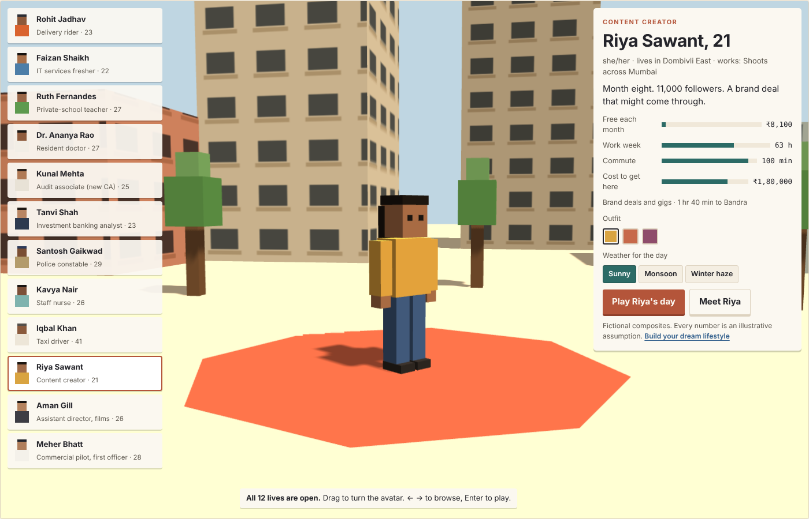

# HowToLife

**Everyone has a dream lifestyle. Discover what it takes to live it.**

HowToLife is a 3D, block-built browser game set in Mumbai that helps teenagers understand the link between careers, money, time and opportunity. Players build their dream lifestyle, step into one of twelve fictional people's lives, live a day with real decisions, watch the month's money arrive and drain away on the 1st, and see possible futures five and fifteen years on.



## Play

Open `index.html` in a modern browser (Chrome, Edge, Firefox or Safari). It needs WebGL and an internet connection to load Three.js and fonts from their CDNs. There is no install, login or backend.

**Controls:** W A S D or arrow keys to move · Shift to run · E to interact · drag to look around · scroll to zoom · Esc for the menu. Driving: W accelerate, S brake, A/D steer. Number keys pick choices in dialogs. On phones, use the on-screen joystick and E button.

## What's inside

- **Twelve playable lives:** delivery rider, IT fresher, private-school teacher, resident doctor, newly qualified CA, investment banking analyst, police constable, staff nurse, taxi driver, content creator, assistant director and commercial pilot. Each has a full profile: education, fees, work history, family circumstances, finances and turning points.
- **A walkable world:** homes, offices, a school, hospital wards, a film set, an airport apron, a sea-front promenade and stations, with sunny, monsoon and winter-haze weather and a full day–night cycle.
- **Driving:** the rider and taxi driver drive through a city map making deliveries and picking up fares.
- **Commutes:** a route planner shows the time and fare of each way to work from where the character lives (local train, AC local, bus, auto, cab and more), adjusted for rain and rush hour. Play the journey or skip it.
- **The 1st of the month:** an itemised settlement that removes ₹1,000 blocks line by line, with separate accounting for salaried and self-employed lives.
- **Futures and your dream:** branching futures based on your choices, compared against the lifestyle you built, plus a reflection to copy.

## Data and honesty

All characters are fictional composites, and institutions marked fictional are invented. **Every amount is an illustrative assumption in 2026 rupees, not verified data.** Figures live in `src/data1.js`, `src/data2.js` and `src/data3.js`, so they can be checked and replaced with sourced numbers. Nothing the player does is sent anywhere; progress is saved only in the browser's local storage.

## Project structure

```
index.html          The built game (single file)
build.sh            Rebuilds index.html from src/
src/head.html       Styles and page markup
src/data*.js        Characters, routes, fares and monthly budgets
src/engine1.js      Renderer, materials, avatars, vehicles, weather, input
src/engine2a.js     Rooms and workplaces
src/engine2b.js     Streets, stations, city maps, rides, showcases
src/engine3.js      Game modes (walk, drive, platform, ride) and main loop
src/game.js         Day runner, dialogs, travel planner, driving goals
src/ui.js           Screens and events
assets/logo/        Logo files (SVG and PNG)
docs/screenshots/   Screenshots
```

Edit files in `src/`, then run `./build.sh` to regenerate `index.html`.

## Built with

[Three.js](https://threejs.org/) r128, plain JavaScript, Google Fonts (Unbounded, Figtree, IBM Plex Mono).
